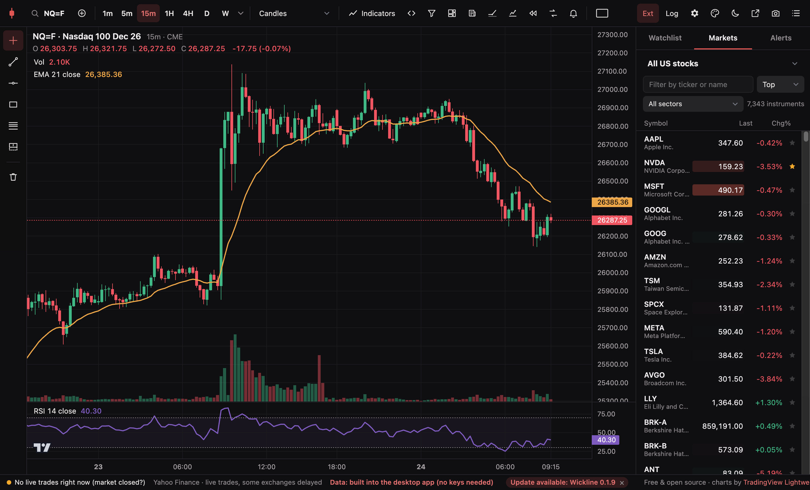
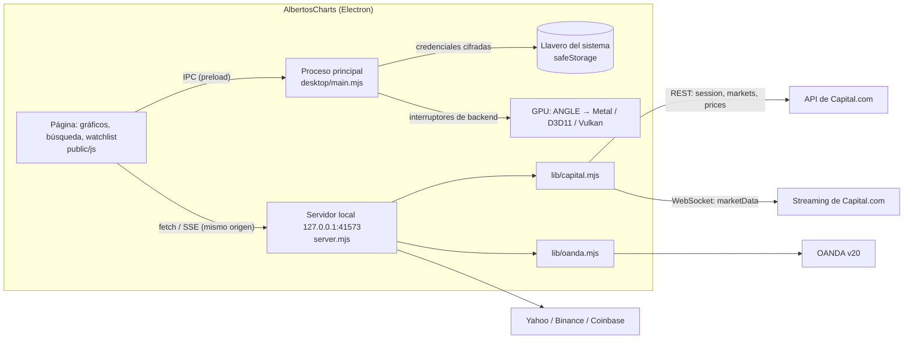

# AlbertosCharts

[English](README.md) · **Español**

Plataforma de gráficos de escritorio al estilo de TradingView, para uso personal. Muestra **CFD en tiempo real** (Nasdaq 100, S&P 500, Dow, DAX, oro…) desde **Capital.com**, dibuja los gráficos con la **GPU** (Metal, Direct3D 11 o Vulkan) y funciona en **Mac Intel con macOS Sequoia**, además de Apple Silicon, Windows y Linux.

Es un fork del proyecto de código abierto [Wickline](https://github.com/keptaduona/wickline) (MIT), que aporta el motor de gráficos, los 100 indicadores, las herramientas de dibujo, las alertas, el screener y mucho más. Este fork añade la conexión con brókers, el backtesting con estadísticas (sesiones, estrategias y journal), la elección del backend de GPU y las protecciones de seguridad que se describen abajo.



---

## Índice

1. [Funciones](#1-funciones)
2. [Requisitos](#2-requisitos)
3. [Instalación (app compilada)](#3-instalación-app-compilada)
4. [Compilar desde el código](#4-compilar-desde-el-código)
5. [Conectar Capital.com (CFD en tiempo real)](#5-conectar-capitalcom-cfd-en-tiempo-real)
6. [Uso de la app](#6-uso-de-la-app)
7. [Aceleración por GPU](#7-aceleración-por-gpu)
8. [Otras fuentes de datos](#8-otras-fuentes-de-datos)
9. [Seguridad y privacidad](#9-seguridad-y-privacidad)
10. [Límites](#10-límites)
11. [Solución de problemas](#11-solución-de-problemas)
12. [Arquitectura](#12-arquitectura)
13. [Desarrollo y tests](#13-desarrollo-y-tests)
14. [Referencia de configuración](#14-referencia-de-configuración)
15. [Créditos y licencia](#15-créditos-y-licencia)

---

## 1. Funciones

**Añadido en este fork**

| Función | Detalle |
| --- | --- |
| CFD de Capital.com en tiempo real | Precios por WebSocket, historial en cualquier temporalidad, búsqueda de mercados y cotizaciones en la watchlist. Cuenta demo o real. |
| OANDA v20 | Bróker CFD alternativo (donde OANDA esté disponible), con token. |
| Gráficos acelerados por GPU | Metal (macOS), Direct3D 11 / Vulkan (Windows), Vulkan (Linux), OpenGL o software. Se elige en ajustes y tiene vuelta automática a un modo seguro. |
| Credenciales cifradas | Guardadas en el llavero del sistema (Llavero de macOS, DPAPI de Windows, Secret Service de Linux). |
| Solo lectura | La app solo consulta precios y mercados: nunca abre, modifica ni cierra órdenes. |
| Servidor local protegido | Los endpoints de brókers solo responden a las páginas de la propia app (sin CORS, con control de `Host` y `Sec-Fetch-Site`). |
| Backtesting y journal | Cada replay es una sesión guardada bajo un usuario y una estrategia, con estadísticas estilo FX Replay / FTMO, curva de equity, desgloses y notas por operación ([sección 6.1](#61-backtesting-y-journal)). |
| Zonas horarias | Haz clic en el reloj: todas las zonas IANA, de UTC−12 a UTC+14. |
| Menú de clic derecho | Restablecer el gráfico, recargar datos, crear una alerta en un precio, borrar dibujos o indicadores. |
| Dibujos por temporalidad | Elige en qué tipos de temporalidad se ve cada dibujo (minutos, horas, días, semanas, meses). |
| Compilación para Mac Intel | `npm run dist:mac-intel` genera un `.dmg` y un `.zip` x86_64. |

**Heredado de Wickline**

- Velas, Heikin-Ashi, línea, área, barras y más; **cualquier temporalidad** (1m, 7m, 45m, 3h, D, S, M…).
- **100 indicadores**, más tus propios indicadores y estrategias en JavaScript con **backtest**.
- Herramientas de dibujo (líneas de tendencia, canales, Fibonacci, rectángulos, posiciones largas/cortas, medición) y **alertas** de precio con notificaciones.
- **De 1 a 8 gráficos** por pantalla, ventanas independientes, comparación de símbolos, escala logarítmica y capturas.
- **Repetición de barras** con trading simulado, screener, mapas de calor, noticias, calendario económico y cadenas de opciones.
- Datos gratuitos sin clave: acciones, ETF, índices, divisas y futuros (Yahoo), y criptomonedas (Binance, Coinbase).

Referencia completa de las funciones heredadas (atajos, API de scripts, backtest): [docs/upstream/README.es.md](docs/upstream/README.es.md) y, más detallada, en inglés: [docs/upstream/README.md](docs/upstream/README.md).

---

## 2. Requisitos

| Para… | Necesitas |
| --- | --- |
| Usar la app | macOS 12 o posterior (Intel o Apple Silicon), Windows 10/11 o Linux de 64 bits |
| Ver CFD en tiempo real | Una cuenta de Capital.com (**basta con una demo**) con 2FA activado y una API key |
| Compilar desde el código | [Node.js](https://nodejs.org) 22 o posterior, `git` y unos 1 GB libres en disco |

---

## 3. Instalación (app compilada)

### macOS (Intel o Apple Silicon)

1. Compila el instalador (ver [sección 4](#4-compilar-desde-el-código)), o descárgalo desde **Releases** del repositorio si hay alguno publicado.
2. Abre `AlbertosCharts-Intel-Mac-1.1.2.dmg` y arrastra **AlbertosCharts** a **Aplicaciones**.
3. Ábrela desde Aplicaciones. La app no está firmada con un certificado de pago de Apple, así que la primera vez macOS la bloquea:
   - Pulsa **OK** (o **Cancelar**). **No** la muevas a la papelera.
   - Abre **Ajustes del Sistema → Privacidad y seguridad**, baja hasta el final y pulsa **Abrir igualmente**. Luego confirma.
   - Si macOS dice que la app "está dañada", ejecuta esto una vez en Terminal:

     ```bash
     xattr -cr "/Applications/AlbertosCharts.app"
     ```

4. La app abre un gráfico de US100. Hasta que conectes Capital.com ([sección 5](#5-conectar-capitalcom-cfd-en-tiempo-real)), ese gráfico muestra un aviso pidiendo tus credenciales. Los símbolos sin clave, como `NQ=F` o `^GSPC`, funcionan desde el primer momento.

### Windows y Linux

Compila con `npm run dist:win` o `npm run dist:linux` ([sección 4](#4-compilar-desde-el-código)). En Windows, si aparece SmartScreen, pulsa **Más información → Ejecutar de todas formas**.

---

## 4. Compilar desde el código

```bash
git clone git@github.com:LucasAlbertodev/trading-app-chart.git
```

```bash
cd trading-app-chart
```

```bash
npm install
```

**Mac: configuración de firma, una sola vez (recomendado).** Crea un certificado local de firma de código, guardado en su propio llavero en `~/Library/Application Support/AlbertosCharts-signing/` y nunca en el repositorio. Desde entonces cada compilación se firma con él, así que macOS sigue confiando en las versiones nuevas y deja de pedir la contraseña del llavero tras cada actualización:

```bash
npm run signing-setup
```

Después compila el instalador para tu sistema:

| Sistema | Comando | Resultado (en `dist/`) |
| --- | --- | --- |
| Mac Intel | `npm run dist:mac-intel` | `AlbertosCharts-Intel-Mac-1.1.2.dmg` y `.zip` |
| Mac (según `package.json`) | `npm run dist:mac` | `.dmg` / `.zip` |
| Windows | `npm run dist:win` | Instalador y `.exe` portátil |
| Linux | `npm run dist:linux` | `.AppImage` y `.deb` |

Para ejecutarla sin empaquetar:

```bash
npm run desktop
```

---

## 5. Conectar Capital.com (CFD en tiempo real)

### Paso 1 — Crear la API key en Capital.com

1. Inicia sesión en [capital.com](https://capital.com) (sirve una cuenta **demo**).
2. Activa la **autenticación en dos pasos (2FA)**. Capital.com la exige para crear una API key.
3. Ve a **Configuración → Integraciones API → Generar nueva clave**.
4. Escribe un nombre, elige una **contraseña propia para la clave** (*no* es la contraseña de tu cuenta), pon una fecha de caducidad si quieres e introduce el código 2FA.
5. **Copia la API key en ese momento.** Capital.com la muestra una sola vez; después aparece oculta.

> La clave dura **1 año** por defecto. Cuando caduque, genera una nueva y pégala en la app.

### Paso 2 — Introducirla en la app

1. Pulsa **⚙** (arriba a la derecha) para abrir **Fuentes de datos**.
2. En la sección **Capital.com**, completa:

   | Campo | Qué poner |
   | --- | --- |
   | Cuenta | **Demo** o **Real (live)**: la cuenta donde generaste la clave (una clave demo no funciona en real, ni al revés) |
   | Usuario (email) | El email con el que entras en Capital.com |
   | API key | La clave del paso 1 |
   | Contraseña de la API key | La **contraseña propia** que elegiste para la clave |

3. Pulsa **Guardar**. La app inicia sesión en ese momento:
   - Si funciona, la sección muestra **Conectado · cuenta …** y los gráficos se recargan.
   - Si no, explica el motivo (por ejemplo, *"Email/login o contraseña de la API key incorrectos"*) y **no guarda nada**.

### Paso 3 — Abrir un CFD

- Haz clic en el nombre del símbolo (o empieza a escribir en cualquier parte) para abrir la búsqueda. Escribe `nasdaq`, `sp500`, `dow`, `dax`, `oro` o `wti`: el CFD de Capital.com aparece primero.
- También puedes escribir el epic directamente: `CAPITAL:US100`, `CAPITAL:US500`, `CAPITAL:US30`, `CAPITAL:DE40`, `CAPITAL:GOLD`, `CAPITAL:OIL_CRUDE`, `CAPITAL:EURUSD`…
- La barra de estado muestra **En vivo** mientras llegan precios, y **Sin operaciones en vivo ahora** mientras el mercado está cerrado (fin de semana, pausa diaria).

> **Recomendación:** usa la cuenta **demo** para ver gráficos. Capital.com no ofrece claves de solo lectura, así que cualquier clave puede operar. Esta app nunca envía órdenes, pero si una clave demo se filtrara, no podría tocar dinero real.

---

## 6. Uso de la app

| Acción | Cómo |
| --- | --- |
| Cambiar de símbolo | Escribe cualquier letra, o haz clic en el nombre del símbolo |
| Cambiar de temporalidad | Escribe un número y pulsa `Enter` (`5`, `45`, `4h`, `1D`), o usa los botones de la cabecera |
| Indicadores y scripts | `/` o el botón **Indicadores** |
| Alerta de precio | `Alt+A` |
| Herramientas de dibujo | `Alt+T` línea de tendencia · `Alt+H` horizontal · `Alt+F` Fibonacci · `Alt+R` rectángulo |
| Varios gráficos | Botón de distribución en la cabecera (de 1 a 8 gráficos) |
| Watchlist / Mercados / Alertas | Panel de la derecha |
| Ajustes | **⚙**: fuentes de datos, Capital.com, OANDA, GPU, proxy, idioma |

**Formato de los símbolos:** `FUENTE:TICKER`

| Ejemplo | Mercado |
| --- | --- |
| `CAPITAL:US100` | CFD del Nasdaq 100 (Capital.com, tiempo real) |
| `CAPITAL:US500` | CFD del S&P 500 (Capital.com, tiempo real) |
| `OANDA:NAS100_USD` | CFD del Nasdaq 100 (OANDA) |
| `YAHOO:NQ=F` · `YAHOO:ES=F` | Futuros del Nasdaq / S&P (sin clave; pueden tener retraso) |
| `YAHOO:^NDX` · `YAHOO:^GSPC` | Índices Nasdaq 100 / S&P 500 (sin clave) |
| `BINANCE:BTCUSDT` | Criptomonedas |

**Cómo se construyen las velas de los CFD:**

- **Precio:** las velas y los precios en vivo usan el **bid**, como la plataforma de Capital.com.
- **Actualización en vivo:** cada cambio de precio mueve la vela actual al instante. Cada 15 segundos la vela se re-sincroniza con las velas oficiales de Capital.com.
- **Volumen:** los CFD no tienen volumen de bolsa, así que el panel de volumen cuenta los cambios de precio (volumen de ticks, como en MetaTrader).
- **Temporalidades:** Capital.com da 1m, 5m, 15m, 30m, 1H, 4H, D y S. Cualquier otra (2m, 45m, 2H, M…) se arma agrupando esas velas.
- **Horarios:** las horas intradía se muestran en la zona horaria de tu ordenador. Las velas diarias siguen el día de negociación del bróker, que cierra a las 17:00 de Nueva York.

### 6.1 Backtesting y journal

Pulsa **Backtesting** en la cabecera. Todo se guarda en tu ordenador (`journal/journal.json`, con copia de seguridad).

1. **Elige el usuario y la estrategia** arriba del panel. Con **⋯** puedes crear, renombrar o borrar usuarios, y crear o editar estrategias (nombre y reglas).
2. **Empieza un replay** (botón Replay) y opera con el panel **Trade**. Cada replay se convierte en una **sesión** del usuario y la estrategia activos, y cada operación cerrada se guarda en ella, junto con su stop y objetivo iniciales, que se usan para el múltiplo R.
3. **Continuar una sesión otro día:** en **Sesiones**, pulsa **Continuar**. El próximo replay se suma a esa sesión y empieza con su balance.
4. **Analiza tus resultados:**
   - **Resumen**: la tabla de estadísticas de abajo, más la curva de equity y el P&L por día de la semana, por hora, por mes y por activo. Pasa el ratón por un gráfico para ver los valores.
   - **Sesiones**: cada sesión con su periodo, operaciones, win rate, P&L y balance.
   - **Operaciones**: cada operación, donde puedes añadir **setup**, **etiquetas** y **notas**.
   - **Estrategias**: una ficha resumen de cada estrategia.
5. **Filtros:** sesión, activo, lado, resultado, rango de fechas y umbral de breakeven. También puedes incluir todas las estrategias a la vez.
6. **Exportar y respaldar:** **Exportar CSV** genera un archivo para Excel o Google Sheets. **Copia (JSON)** e **Importar JSON** sirven para copiar o restaurar todo el journal; importar nunca borra nada.

| Estadística | Qué significa |
| --- | --- |
| P&L total, Balance | Resultado neto en $ y %, y el balance desde el monto inicial |
| Win rate | Ganadoras ÷ todas las operaciones (las que quedan dentro del umbral cuentan como breakeven) |
| Profit factor | Ganancia bruta ÷ pérdida bruta |
| R:R medio | Ganancia media ÷ pérdida media |
| Expectativa | $ promedio por operación |
| R medio / ΣR | Resultado en múltiplos del riesgo inicial (operaciones con stop) |
| Drawdown máx. | Mayor caída desde un máximo de equity, en $ y % |
| Factor de recuperación | P&L neto ÷ drawdown máximo |
| Rachas | Racha más larga de ganadoras y de perdedoras |
| Sharpe (por op.) | Media ÷ desviación estándar del rendimiento por operación |
| Media diaria / semanal / mensual | P&L promedio por día, semana y mes operados |
| Mejor / peor día, Largos / Cortos | Desglose por día y por lado |

Los días y las horas siguen la zona horaria elegida en el reloj.

> **Preparado para el journal:** cada operación ya guarda campos de etiquetas, notas, setup y emoción, y cada sesión tiene un tipo (`backtest` hoy; `paper`, `live` y `prop` más adelante). El archivo lleva una versión de esquema que se migra sola, así que el futuro journal de operaciones reales puede reutilizar los mismos datos.

### 6.2 Zona horaria, menú de clic derecho y dibujos

- **Zona horaria:** haz clic en el reloj (abajo a la derecha) y busca una ciudad o un desfase (por ejemplo `UTC-3`). La zona se aplica al reloj, a las estadísticas de backtesting y a los gráficos de Capital.com, OANDA y cripto. Los gráficos de Yahoo mantienen la hora de su bolsa.
- **Clic derecho en el gráfico:**
  - **Restablecer gráfico:** recupera la escala y el zoom.
  - **Recargar datos:** vuelve a pedir el historial de precios.
  - **Restablecer datos y gráfico:** hace las dos cosas.
  - También puedes crear una alerta en el precio donde hiciste clic, borrar los dibujos del símbolo o quitar todos los indicadores.
- **Dibujos por temporalidad:**
  1. Selecciona un dibujo y pulsa **Temporalidades**.
  2. Marca los tipos de temporalidad donde debe verse: minutos, horas, días, semanas, meses. Por ejemplo, un nivel del diario que no ensucie el gráfico de 5 minutos.
  3. Opcional: marca **Dibujos nuevos: solo en el tipo de temporalidad actual** para que sea el comportamiento por defecto de los dibujos nuevos.


---

## 7. Aceleración por GPU

Los gráficos se dibujan en un canvas HTML. Chromium (dentro de Electron) dibuja ese canvas y compone la ventana en la GPU a través de **ANGLE**, que traduce a la API gráfica nativa.

| Sistema | Por defecto | Otras opciones |
| --- | --- | --- |
| macOS (Intel y Apple Silicon) | **Metal** | OpenGL, desactivada |
| Windows | **Direct3D 11** | Vulkan, OpenGL, desactivada |
| Linux | **Vulkan** | OpenGL, desactivada |

**Cambiarlo:** ve a **⚙ → Aceleración por GPU → Backend gráfico**, elige uno y pulsa **Guardar**. La app se reinicia.

**Ver cuál se está usando:** la insignia abajo a la derecha muestra la API activa (por ejemplo `GPU · Metal`). Pasa el ratón por encima para ver la tarjeta gráfica y si los gráficos los dibuja la GPU.

**Vuelta automática:** si el proceso de la GPU se cae dos veces con un backend, la app pasa a OpenGL (y después a software) y se reinicia, para que la ventana nunca quede en negro.

**También activado:**
- Rasterización en GPU y subidas sin copias (zero-copy).
- Se ignora la lista negra de GPUs, así que las GPUs Intel antiguas también se usan.
- En Mac con dos GPUs se prefiere la dedicada (alto rendimiento).

> Direct3D 11 solo existe en Windows. Vulkan a través de ANGLE está disponible en Windows y Linux; en macOS la app usa Metal.

---

## 8. Otras fuentes de datos

| Fuente | Símbolos | Tiempo real | Necesita |
| --- | --- | --- | --- |
| **Capital.com** | `CAPITAL:` | Sí (WebSocket) | Cuenta y API key |
| **OANDA v20** | `OANDA:` | Sí (streaming) | Cuenta y token (**no disponible en todos los países**, p. ej. Argentina) |
| Yahoo Finance | `YAHOO:` | En parte (algunas bolsas y los futuros de CME con retraso) | Nada |
| Binance / Coinbase | `BINANCE:` `BINANCEF:` `COINBASE:` | Sí | Nada |

**OANDA:** ve a **⚙ → OANDA**, elige Demo o Real, pega el token de *Mi cuenta → Gestionar acceso API* y pulsa **Guardar**.

**Proxy de red:** si alguna fuente está bloqueada donde estás, ve a **⚙ → Proxy de red**. Puedes usar el proxy del sistema, o un proxy HTTP / SOCKS5 como `127.0.0.1:7890`.

---

## 9. Seguridad y privacidad

- **Dónde se guardan las credenciales:**
  - Se guardan **cifradas** con el llavero del sistema (`safeStorage` de Electron), en archivos que solo tu usuario puede leer (`0600`).
  - Solo se envían **al bróker**.
  - La página web nunca las ve: los ajustes solo muestran si hay una clave guardada.
- **Solo lectura:** la app solo usa estos endpoints:
  - Capital.com: `session`, `markets`, `prices`, `ping` y el WebSocket de datos de mercado.
  - OANDA: `accounts`, `instruments`, `candles`, `pricing`.
  - No hay ningún código que cree, modifique o cierre órdenes o posiciones.
- **Servidor local:** la app ejecuta un pequeño servidor en `127.0.0.1:41573`. Sus endpoints `/api/capital/*` y `/api/oanda/*`:
  - no envían cabeceras CORS, así que otras webs no pueden leer sus respuestas;
  - rechazan peticiones cuyo `Host` no sea local (protección contra DNS rebinding);
  - rechazan peticiones de otros sitios (`Sec-Fetch-Site` / `Origin`), así que una web abierta en tu navegador no puede usar tu sesión del bróker ni ocupar tus suscripciones en tiempo real.
- **Scripts propios y de la comunidad:** corren en un worker aislado con una CSP que bloquea todo acceso a la red, así que no pueden llegar a tus credenciales.
- **Riesgo restante:** otros programas que corran en tu propio ordenador pueden pedir precios a través del servidor local mientras la app está abierta. No pueden leer tus credenciales ni operar.
- **Dependencias:** `npm audit --omit=dev` no encuentra vulnerabilidades conocidas en el momento de escribir esto.

---

## 10. Límites

| Límite | Valor | Efecto en la app |
| --- | --- | --- |
| Sesión de Capital.com | 10 minutos sin actividad | Automático: ping cada 4 min y nuevo login si caduca |
| API key de Capital.com | 1 año por defecto | Genera una nueva y pégala en ⚙ |
| WebSocket de Capital.com | Máximo **40 instrumentos** a la vez | Suma gráficos y watchlist; los que sobren no reciben precios en vivo |
| Velas por petición | Máximo 1000 | El historial anterior se carga al desplazarte hacia atrás |
| Ritmo de peticiones | 10 por segundo (1 login por segundo) | La app espacia sus peticiones |
| Cuenta demo | Capital.com no documenta si caduca | Consulta a support@capital.com si tienes dudas |

---

## 11. Solución de problemas

| Problema | Qué hacer |
| --- | --- |
| macOS no deja abrir la app | **Abrir igualmente** en Privacidad y seguridad, o `xattr -cr "/Applications/AlbertosCharts.app"` ([sección 3](#3-instalación-app-compilada)) |
| *"Capital.com no está configurado"* | Completa los cuatro campos en ⚙ → Capital.com |
| *"Email/login o contraseña de la API key incorrectos"* | Usa la **contraseña propia de la clave**, no la de tu cuenta |
| *"La API key no es válida"* | Comprueba que **Demo/Real** coincida con la cuenta donde generaste la clave; la clave puede estar pausada, caducada o borrada |
| El gráfico dice *"Sin operaciones en vivo ahora"* | El mercado está cerrado (fin de semana, pausa diaria), o hay más de 40 instrumentos abiertos |
| Ventana negra o parpadeos | ⚙ → GPU → elige **OpenGL** o **Desactivada**; o arranca una vez con `WICKLINE_GPU=gl` ([sección 14](#14-referencia-de-configuración)) |
| Tras una actualización, macOS pide usar "albertoscharts Safe Storage" del llavero | Es la clave de la propia app para tus credenciales cifradas, así que es seguro permitirlo. Escribe la contraseña de inicio de sesión del Mac y pulsa **Permitir siempre**. Con compilaciones firmadas mediante `npm run signing-setup` solo pasa una vez; las firmadas ad hoc lo piden después de cada actualización |
| No conecta con Yahoo, Binance o Capital.com | ⚙ → Proxy de red |
| Tras actualizar desde "Wickline CFD", Capital.com dice "no configurado" | La watchlist, los dibujos, los layouts y los ajustes se copian solos. Las credenciales de Capital.com estaban cifradas con el nombre anterior de la app, así que introdúcelas otra vez, una sola vez, en ⚙ |
| El diálogo de ajustes es más alto que la ventana | Se desplaza, y **Guardar** queda siempre visible abajo. OANDA está plegado en *Otros brókers* |

---

## 12. Arquitectura



**Estructura del proyecto (archivos que este fork añade o modifica):**

```
lib/capital.mjs          Capital.com: sesión, velas, búsqueda, cotizaciones, streaming por WebSocket
lib/oanda.mjs            OANDA v20: velas, cotizaciones, streaming de precios
desktop/gpu.mjs          Elección del backend de GPU, vuelta automática, estado de la GPU
desktop/main.mjs         Proceso principal de Electron: credenciales cifradas, IPC
desktop/preload.cjs      Puente expuesto a la página (getCapital/setCapital, getGpu/setGpu…)
server.mjs               Servidor local, endpoints /api/capital/* y /api/oanda/* y sus protecciones
public/js/datafeed.js    BrokerFeed / BrokerLive: gráficos y precios en vivo de CAPITAL: y OANDA:
public/js/search.js      Resultados de Capital.com y OANDA en la búsqueda de símbolos
public/js/app.js         Ajustes, insignia de GPU, reloj/zonas horarias, menú de clic derecho, watchlist por defecto
public/js/journal.js     Datos del journal: usuarios, estrategias, sesiones, operaciones (esquema + migración)
public/js/journal-stats.js  Estadísticas: P&L, win rate, PF, R, drawdown, rachas, desgloses
public/js/backtest-panel.js Panel de Backtesting: resumen, sesiones, operaciones, estrategias, gráficos
public/js/tz.js          Zonas horarias (todas las IANA, desfases con horario de verano)
public/js/drawings.js    Dibujos, con visibilidad por temporalidad
test/brokers.test.mjs    Tests de brókers y de seguridad del servidor (APIs simuladas, sin red)
test/journal.test.mjs    Tests del journal, las estadísticas, las zonas horarias y la visibilidad de dibujos
docs/upstream/           Documentación original de Wickline
```

---

## 13. Desarrollo y tests

```bash
npm install
```

Ejecutar la app en modo desarrollo:

```bash
npm run desktop
```

Ejecutar solo el servidor local y abrir `http://127.0.0.1:5173` en el navegador. Las credenciales de Capital.com se pasan por variables de entorno (ver [sección 14](#14-referencia-de-configuración)):

```bash
npm start
```

Ejecutar todos los tests:

```bash
npm test
```

- `test/brokers.test.mjs` prueba Capital.com y OANDA contra **APIs simuladas**, así que no necesita red ni credenciales reales. Comprueba:
  - el login y sus mensajes de error, una sola sesión compartida y el nuevo login cuando la sesión caduca;
  - las velas en temporalidades nativas y agrupadas, las etiquetas diarias y la carga de historial anterior;
  - las cotizaciones y la búsqueda;
  - las suscripciones por WebSocket, incluido el tope de 40 instrumentos y que no se dupliquen conexiones;
  - las protecciones del servidor local: peticiones de otros sitios, DNS rebinding y parámetros malos.
- `test/community.test.mjs` va al final y necesita **Docker**. Sin Docker, sus 4 comprobaciones de "verdict" fallan; es lo esperado.

**Smoke test** (arranca la app oculta, carga un gráfico, imprime qué cargó y qué GPU se usa, y se cierra):

```bash
WICKLINE_SMOKE_TEST=1 WICKLINE_SMOKE_SYMBOL=CAPITAL:US100 WICKLINE_SMOKE_TF=5m npm run desktop
```

---

## 14. Referencia de configuración

**Archivos** (macOS: `~/Library/Application Support/AlbertosCharts/`; Windows: `%APPDATA%\AlbertosCharts\`; Linux: `~/.config/AlbertosCharts/`):

| Archivo | Contenido |
| --- | --- |
| `capital.json` | Entorno de Capital.com, más login, API key y contraseña (cifrados) |
| `oanda.json` | Entorno y token de OANDA (cifrado) |
| `gpu.json` | Backend de GPU elegido y la última vuelta automática |
| `proxy.json` | Ajuste de proxy de red |
| `journal/journal.json` (+ `journal.bak.json`) | Journal de backtesting: usuarios, estrategias, sesiones y operaciones |
| `window-state.json` | Tamaño y posición de la ventana |

Los gráficos, dibujos, scripts y watchlists los guarda la propia página (almacenamiento local de la ventana de la app).

**Variables de entorno:**

| Variable | La usa | Significado |
| --- | --- | --- |
| `CAPITAL_API_KEY`, `CAPITAL_IDENTIFIER`, `CAPITAL_PASSWORD` | `npm start` | Credenciales de Capital.com (la app de escritorio usa ⚙ en su lugar) |
| `CAPITAL_ENV` | `npm start` | `demo` (por defecto) o `live` |
| `OANDA_TOKEN`, `OANDA_ENV` | `npm start` | Token de OANDA, `practice` (por defecto) o `live` |
| `WICKLINE_GPU` | App de escritorio | Fuerza el backend de GPU en un arranque: `metal`, `d3d11`, `vulkan`, `gl`, `off` |
| `WICKLINE_PROXY` | `npm start` | Proxy del servidor (`host:puerto` o `socks5://host:puerto`) |
| `PORT`, `HOST` | `npm start` | Dirección del servidor (por defecto `127.0.0.1:5173`) |
| `WICKLINE_SMOKE_TEST`, `WICKLINE_SMOKE_SYMBOL`, `WICKLINE_SMOKE_TF`, `WICKLINE_SMOKE_SHOT` | App de escritorio | Smoke test automático |

---

## 15. Créditos y licencia

- Basado en [Wickline](https://github.com/keptaduona/wickline), de los colaboradores de Wickline. La documentación original está en [docs/upstream/](docs/upstream/README.es.md).
- Gráficos de [TradingView Lightweight Charts™](https://www.tradingview.com/lightweight-charts/).
- Capital.com y OANDA son marcas de sus propietarios. Este proyecto no está afiliado a ellos ni respaldado por ellos, y nada de lo que hay aquí es asesoramiento de inversión.
- Licencia: [MIT](LICENSE), la misma del proyecto original.
