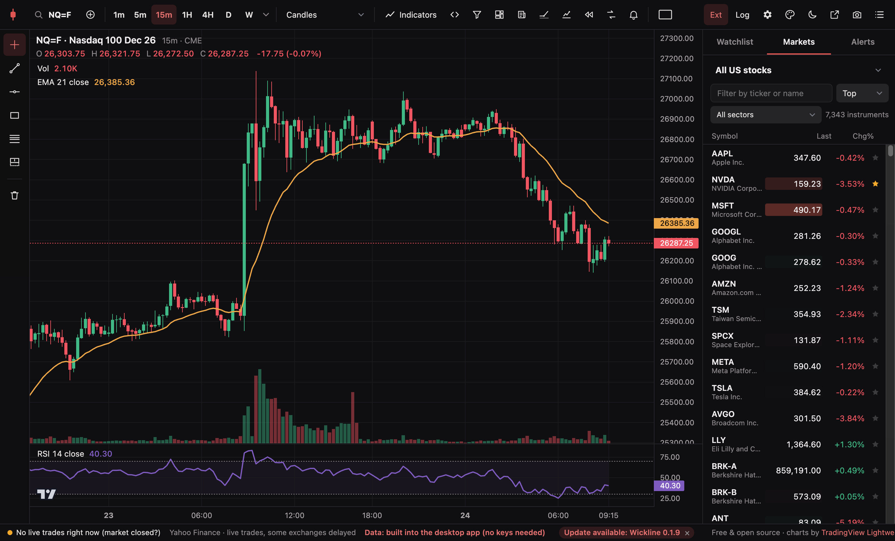
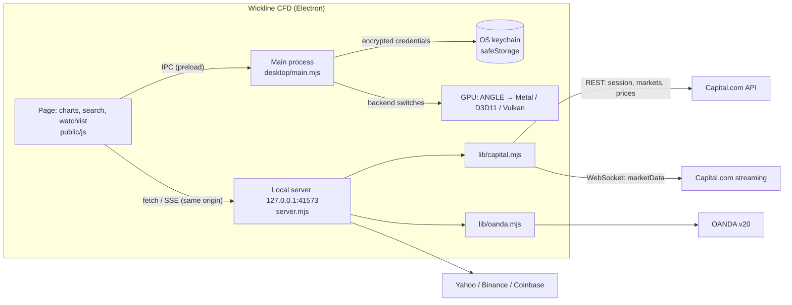

# Trading App Chart — Wickline CFD

**English** · [Español](README.es.md)

A desktop charting platform in the spirit of TradingView, built for personal use. It charts **CFDs in real time** (Nasdaq 100, S&P 500, Dow, DAX, gold…) from **Capital.com**, draws the charts on the **GPU** (Metal, Direct3D 11 or Vulkan), and runs on **Intel Macs with macOS Sequoia**, as well as Apple Silicon, Windows and Linux.

It is a fork of the open-source [Wickline](https://github.com/keptaduona/wickline) (MIT), which provides the charting engine, the 100 built-in indicators, drawing tools, alerts, the screener and much more. This fork adds the broker connections, GPU backend selection and the security hardening described below.



---

## Table of contents

1. [Features](#1-features)
2. [Requirements](#2-requirements)
3. [Install (pre-built app)](#3-install-pre-built-app)
4. [Build from source](#4-build-from-source)
5. [Connect Capital.com (real-time CFDs)](#5-connect-capitalcom-real-time-cfds)
6. [Using the app](#6-using-the-app)
7. [GPU acceleration](#7-gpu-acceleration)
8. [Other data sources](#8-other-data-sources)
9. [Security and privacy](#9-security-and-privacy)
10. [Limits](#10-limits)
11. [Troubleshooting](#11-troubleshooting)
12. [Architecture](#12-architecture)
13. [Development and tests](#13-development-and-tests)
14. [Configuration reference](#14-configuration-reference)
15. [Credits and license](#15-credits-and-license)

---

## 1. Features

**Added in this fork**

| Feature | Details |
| --- | --- |
| Capital.com CFDs in real time | Prices streamed over WebSocket, history for every timeframe, market search, watchlist quotes. Demo or live account. |
| OANDA v20 | Alternative CFD broker (where OANDA is available), with token. |
| GPU-accelerated charts | Metal (macOS), Direct3D 11 / Vulkan (Windows), Vulkan (Linux), OpenGL, or software. Chosen in settings, with automatic fallback. |
| Encrypted credentials | Stored in the operating system's keychain (macOS Keychain, Windows DPAPI, Linux Secret Service). |
| Read-only by design | The app only calls price and market endpoints: it never places, edits or closes orders. |
| Hardened local server | Broker endpoints only answer the app's own pages (no CORS, Host and `Sec-Fetch-Site` checks). |
| Intel Mac build | `npm run dist:mac-intel` produces an x86_64 `.dmg` and `.zip`. |

**Inherited from Wickline**

- Candles, Heikin-Ashi, line, area, bars and more; **any timeframe** (1m, 7m, 45m, 3h, D, W, M…).
- **100 built-in indicators**, plus your own indicators and strategies in JavaScript with **backtesting**.
- Drawing tools (trend lines, channels, Fibonacci, rectangles, long/short positions, measure), price **alerts** with notifications.
- **1 to 8 charts** per screen, pop-out windows, compare symbols, log scale, screenshots.
- **Bar replay** with paper trading, screener, heatmaps, news and economic calendar, option chains.
- Free keyless data: stocks, ETFs, indices, forex and futures (Yahoo), crypto (Binance, Coinbase).

Full reference for the inherited features (shortcuts, scripting API, backtesting): [docs/upstream/README.md](docs/upstream/README.md).

---

## 2. Requirements

| To… | You need |
| --- | --- |
| Run the app | macOS 12 or later (Intel or Apple Silicon), Windows 10/11, or a 64-bit Linux |
| See real-time CFDs | A Capital.com account (a **demo account is enough**) with 2FA turned on and an API key |
| Build from source | [Node.js](https://nodejs.org) 22 or later, `git`, and about 1 GB of free disk space |

---

## 3. Install (pre-built app)

### macOS (Intel or Apple Silicon)

1. Build the installer (see [section 4](#4-build-from-source)), or download it from the repository's **Releases** page if one has been published.
2. Open `Wickline CFD-Intel-Mac-1.0.0.dmg` and drag **Wickline CFD** into **Applications**.
3. Open it from Applications. The app is not signed with a paid Apple certificate, so the first time macOS blocks it:
   - Click **Done** (or **Cancel**). **Do not** move it to the Trash.
   - Open **System Settings → Privacy & Security**, scroll down and click **Open Anyway**, then confirm.
   - If macOS says the app "is damaged", run this once in Terminal:

     ```bash
     xattr -cr "/Applications/Wickline CFD.app"
     ```

4. The app opens on a US100 chart. Until you connect Capital.com ([section 5](#5-connect-capitalcom-real-time-cfds)), that chart shows a message asking for your credentials. Keyless symbols such as `NQ=F` or `^GSPC` work right away.

### Windows and Linux

Build with `npm run dist:win` or `npm run dist:linux` ([section 4](#4-build-from-source)). On Windows, if SmartScreen warns you, click **More info → Run anyway**.

---

## 4. Build from source

```bash
git clone git@github.com:LucasAlbertodev/trading-app-chart.git
```

```bash
cd trading-app-chart
```

```bash
npm install
```

Then build the installer for your platform:

| Platform | Command | Output (in `dist/`) |
| --- | --- | --- |
| Intel Mac | `npm run dist:mac-intel` | `Wickline CFD-Intel-Mac-1.0.0.dmg` and `.zip` |
| Mac (as configured in `package.json`) | `npm run dist:mac` | `.dmg` / `.zip` |
| Windows | `npm run dist:win` | Installer and portable `.exe` |
| Linux | `npm run dist:linux` | `.AppImage` and `.deb` |

To run it without packaging:

```bash
npm run desktop
```

---

## 5. Connect Capital.com (real-time CFDs)

### Step 1 — Create the API key on Capital.com

1. Sign in at [capital.com](https://capital.com) (a **demo** account works).
2. Turn on **two-factor authentication (2FA)**. Capital.com requires it before it will create an API key.
3. Go to **Settings → API integrations → Generate new key**.
4. Enter a label, choose a **custom password for the key** (this is *not* your account password), optionally set an expiry date, and enter your 2FA code.
5. **Copy the API key now.** Capital.com shows it only once, then masks it.

> The key is valid for **1 year** by default. When it expires, generate a new one and paste it in the app.

### Step 2 — Enter it in the app

1. Click **⚙** (top right), which opens **Data sources**.
2. In the **Capital.com** section, fill in:

   | Field | What to enter |
   | --- | --- |
   | Account | **Demo** or **Live**: the account where you generated the key (a demo key does not work on live, and vice versa) |
   | Login (email) | The email you sign in to Capital.com with |
   | API key | The key from step 1 |
   | API key password | The **custom password** you chose for the key |

3. Click **Save**. The app signs in straight away:
   - If it works, the section shows **Connected · account …** and the charts reload.
   - If not, it says why and **saves nothing**. Broker error messages are shown in Spanish, for example *"Email/login o contraseña de la API key incorrectos"* (wrong login or key password).

### Step 3 — Chart a CFD

- Click the symbol name (or start typing anywhere) to open search. Type `nasdaq`, `sp500`, `dow`, `dax`, `oro`/`gold` or `wti`: the Capital.com CFD appears first.
- Or type the epic directly: `CAPITAL:US100`, `CAPITAL:US500`, `CAPITAL:US30`, `CAPITAL:DE40`, `CAPITAL:GOLD`, `CAPITAL:OIL_CRUDE`, `CAPITAL:EURUSD`…
- The status bar shows **Live** while prices are streaming, and **No live trades right now** while the market is closed (weekends, daily break).

> **Recommendation:** stay on the **demo** account for charting. Capital.com does not offer read-only keys, so any key can trade. This app never sends orders, but a demo key can never touch real money if it leaks.

---

## 6. Using the app

| Action | How |
| --- | --- |
| Change symbol | Type any letter, or click the symbol name |
| Change timeframe | Type a number and press `Enter` (`5`, `45`, `4h`, `1D`), or use the header buttons |
| Indicators and scripts | `/` or the **Indicators** button |
| Price alert | `Alt+A` |
| Drawing tools | `Alt+T` trend line · `Alt+H` horizontal · `Alt+F` Fibonacci · `Alt+R` rectangle |
| Several charts | Layout button in the header (1 to 8 charts) |
| Watchlist / Markets / Alerts | Right-hand panel |
| Settings | **⚙**: data sources, Capital.com, OANDA, GPU, proxy, language |

**Symbol format:** `SOURCE:TICKER`

| Example | Market |
| --- | --- |
| `CAPITAL:US100` | Nasdaq 100 CFD (Capital.com, real time) |
| `CAPITAL:US500` | S&P 500 CFD (Capital.com, real time) |
| `OANDA:NAS100_USD` | Nasdaq 100 CFD (OANDA) |
| `YAHOO:NQ=F` · `YAHOO:ES=F` | Nasdaq / S&P futures (keyless, may be delayed) |
| `YAHOO:^NDX` · `YAHOO:^GSPC` | Nasdaq 100 / S&P 500 indices (keyless) |
| `BINANCE:BTCUSDT` | Crypto |

**How CFD candles are built:**

- **Price:** candles and live prices use the **bid**, like the Capital.com platform.
- **Live updates:** each price update moves the current candle at once. Every 15 seconds the candle is re-synced with Capital.com's official candles.
- **Volume:** CFDs have no exchange volume, so the volume pane counts price updates (tick volume, as in MetaTrader).
- **Timeframes:** Capital.com provides 1m, 5m, 15m, 30m, 1H, 4H, D and W. Any other timeframe (2m, 45m, 2H, M…) is built by grouping those candles.
- **Times:** intraday times are shown in your computer's time zone. Daily candles follow the broker's trading day, which ends at 17:00 New York time.

---

## 7. GPU acceleration

The charts are drawn on HTML canvas. Chromium (inside Electron) draws that canvas and composes the window on the GPU through **ANGLE**, which translates to the native graphics API.

| System | Default | Other options |
| --- | --- | --- |
| macOS (Intel and Apple Silicon) | **Metal** | OpenGL, off |
| Windows | **Direct3D 11** | Vulkan, OpenGL, off |
| Linux | **Vulkan** | OpenGL, off |

**Change it:** go to **⚙ → GPU acceleration → Graphics backend**, pick one and click **Save**. The app restarts.

**See what is in use:** the badge at the bottom right shows the active API (for example `GPU · Metal`). Hover over it to see the graphics card and whether the charts are drawn by the GPU.

**Automatic fallback:** if the GPU process crashes twice with a backend, the app switches to OpenGL (and then to software) and restarts, so the window never stays black.

**Also enabled:**
- GPU rasterization and zero-copy uploads.
- The GPU blocklist is ignored, so older Intel GPUs are still used.
- On Macs with two GPUs, the discrete (high-performance) GPU is preferred.

> Direct3D 11 exists only on Windows. Vulkan through ANGLE is available on Windows and Linux; on macOS the app uses Metal.

---

## 8. Other data sources

| Source | Symbols | Real time | Needs |
| --- | --- | --- | --- |
| **Capital.com** | `CAPITAL:` | Yes (WebSocket) | Account + API key |
| **OANDA v20** | `OANDA:` | Yes (streaming) | Account + token (**not available in every country**, e.g. Argentina) |
| Yahoo Finance | `YAHOO:` | Partly (some exchanges and CME futures delayed) | Nothing |
| Binance / Coinbase | `BINANCE:` `BINANCEF:` `COINBASE:` | Yes | Nothing |

**OANDA:** go to **⚙ → OANDA**, choose Practice or Live, paste the token from *My Account → Manage API Access*, and click **Save**.

**Network proxy:** if any source is blocked where you are, go to **⚙ → Network proxy**. You can use the system proxy, or an HTTP / SOCKS5 proxy such as `127.0.0.1:7890`.

---

## 9. Security and privacy

- **Where credentials live:**
  - They are saved **encrypted** with the operating system's keychain (Electron `safeStorage`), in files that only your user can read (`0600`).
  - They are sent **only** to the broker.
  - The web page never sees them: the settings only show whether a key is saved.
- **Read-only:** the app only uses these endpoints:
  - Capital.com: `session`, `markets`, `prices`, `ping` and the market-data WebSocket.
  - OANDA: `accounts`, `instruments`, `candles`, `pricing`.
  - There is no code that creates, edits or closes orders or positions.
- **Local server:** the app runs a small server on `127.0.0.1:41573`. Its `/api/capital/*` and `/api/oanda/*` endpoints:
  - send no CORS headers, so other websites cannot read their responses;
  - reject requests whose `Host` is not local (protection against DNS rebinding);
  - reject cross-site requests (`Sec-Fetch-Site` / `Origin`), so a website open in your browser cannot use your broker session or take over your real-time subscriptions.
- **User and community scripts:** they run in a sandboxed worker with a CSP that blocks all network access, so they cannot reach your credentials.
- **Remaining risk:** other programs running on your own computer can request prices through the local server while the app is open. They cannot read your credentials or trade.
- **Dependencies:** `npm audit --omit=dev` reports no known vulnerabilities at the time of writing.

---

## 10. Limits

| Limit | Value | Effect in the app |
| --- | --- | --- |
| Capital.com session | 10 minutes without activity | Handled automatically: ping every 4 min, re-login on expiry |
| Capital.com API key | 1 year by default | Generate a new key and paste it in ⚙ |
| Capital.com WebSocket | Max **40 instruments** at once | Charts + watchlist together; extra symbols get no live updates |
| Candles per request | Max 1000 | Older history loads as you scroll back |
| Request rate | 10 per second (1 login per second) | The app paces its requests |
| Demo account | Expiry rules not documented by Capital.com | Ask support@capital.com if in doubt |

---

## 11. Troubleshooting

| Problem | What to do |
| --- | --- |
| macOS won't open the app | Use **Open Anyway** in Privacy & Security, or `xattr -cr "/Applications/Wickline CFD.app"` ([section 3](#3-install-pre-built-app)) |
| *"Capital.com no está configurado"* (not configured) | Fill in all four fields in ⚙ → Capital.com |
| *"…contraseña de la API key incorrectos"* (wrong login or password) | Use the key's **custom password**, not your account password |
| *"La API key no es válida"* (invalid key) | Check **Demo/Live** matches the account where you generated the key; the key may be paused, expired or deleted |
| Chart stuck on "No live trades right now" | The market is closed (weekend, daily break), or more than 40 instruments are open |
| Black window or flickering | ⚙ → GPU → choose **OpenGL** or **Off**; or start once with `WICKLINE_GPU=gl` ([section 14](#14-configuration-reference)) |
| Can't reach Yahoo, Binance or Capital.com | ⚙ → Network proxy |
| Old "Update available: Wickline …" notice | Ignore it: updates for this fork come from this repository |

---

## 12. Architecture



**Project layout (files this fork added or changed):**

```
lib/capital.mjs          Capital.com: session, candles, search, quotes, WebSocket streamer
lib/oanda.mjs            OANDA v20: candles, quotes, pricing stream
desktop/gpu.mjs          GPU backend selection, crash fallback, GPU status
desktop/main.mjs         Electron main process: encrypted credentials, IPC
desktop/preload.cjs      Bridge exposed to the page (getCapital/setCapital, getGpu/setGpu…)
server.mjs               Local server, /api/capital/* and /api/oanda/* endpoints and their guards
public/js/datafeed.js    BrokerFeed / BrokerLive: charts and live prices for CAPITAL: and OANDA:
public/js/search.js      Capital.com and OANDA results in symbol search
public/js/app.js         Settings UI (Capital.com, OANDA, GPU), GPU badge, default watchlist
test/brokers.test.mjs    Broker and server-security tests (mocked APIs, no network)
docs/upstream/           The original Wickline documentation
```

---

## 13. Development and tests

```bash
npm install
```

Run the app in development:

```bash
npm run desktop
```

Run the local server only, then open `http://127.0.0.1:5173` in a browser. Pass Capital.com credentials as environment variables (see [section 14](#14-configuration-reference)):

```bash
npm start
```

Run all tests:

```bash
npm test
```

- `test/brokers.test.mjs` covers Capital.com and OANDA against **mocked APIs**, so it needs no network or real credentials. It checks:
  - login and its error messages, a single shared session, and re-login when the session expires;
  - candles for native and grouped timeframes, daily labels, and loading older history;
  - quotes and search;
  - WebSocket subscriptions, including the 40-instrument cap and no duplicate connections;
  - the local server's guards: cross-site requests, DNS rebinding and bad parameters.
- `test/community.test.mjs` runs last and needs **Docker**. Without Docker, its 4 "verdict" checks fail; this is expected.

**Smoke test** (starts the app hidden, loads a chart, prints what loaded and which GPU is in use, then quits):

```bash
WICKLINE_SMOKE_TEST=1 WICKLINE_SMOKE_SYMBOL=CAPITAL:US100 WICKLINE_SMOKE_TF=5m npm run desktop
```

---

## 14. Configuration reference

**Files** (macOS: `~/Library/Application Support/Wickline CFD/`; Windows: `%APPDATA%\Wickline CFD\`; Linux: `~/.config/Wickline CFD/`):

| File | Contents |
| --- | --- |
| `capital.json` | Capital.com environment, plus login, API key and password (encrypted) |
| `oanda.json` | OANDA environment and token (encrypted) |
| `gpu.json` | Chosen GPU backend, and the last automatic fallback |
| `proxy.json` | Network proxy setting |
| `window-state.json` | Window size and position |

Charts, drawings, scripts and watchlists are stored by the page itself (local storage of the app's window).

**Environment variables:**

| Variable | Used by | Meaning |
| --- | --- | --- |
| `CAPITAL_API_KEY`, `CAPITAL_IDENTIFIER`, `CAPITAL_PASSWORD` | `npm start` | Capital.com credentials (the desktop app uses ⚙ instead) |
| `CAPITAL_ENV` | `npm start` | `demo` (default) or `live` |
| `OANDA_TOKEN`, `OANDA_ENV` | `npm start` | OANDA token, `practice` (default) or `live` |
| `WICKLINE_GPU` | Desktop app | Overrides the GPU backend for one launch: `metal`, `d3d11`, `vulkan`, `gl`, `off` |
| `WICKLINE_PROXY` | `npm start` | Proxy for the server (`host:port` or `socks5://host:port`) |
| `PORT`, `HOST` | `npm start` | Server address (default `127.0.0.1:5173`) |
| `WICKLINE_SMOKE_TEST`, `WICKLINE_SMOKE_SYMBOL`, `WICKLINE_SMOKE_TF`, `WICKLINE_SMOKE_SHOT` | Desktop app | Automated smoke test |

---

## 15. Credits and license

- Based on [Wickline](https://github.com/keptaduona/wickline) by the Wickline contributors. The original documentation is in [docs/upstream/](docs/upstream/README.md).
- Charts by [TradingView Lightweight Charts™](https://www.tradingview.com/lightweight-charts/).
- Capital.com and OANDA are trademarks of their owners. This project is not affiliated with or endorsed by them, and nothing here is investment advice.
- License: [MIT](LICENSE), the same as the original project.
